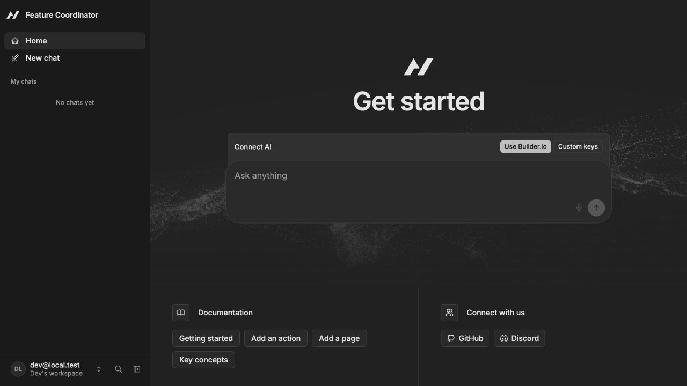

# Foundation verification: November 3, 2026

## Result

Official Agent-Native standalone Chat scaffold created at `feature-coordinator/`. This is a running starter, not an implemented feature coordination workflow.

Verified local URL: [http://localhost:8080/](http://localhost:8080/), HTTP 200. Local developer sign-in was exercised in the browser and reached `/home`, displaying Feature Coordinator, the Get started screen, and the model connection controls. No provider key was entered and no LLM call was made. The development server was left running for review.

## Installed stack and checks

- Node.js v24.16.0; pnpm’s generated package-manager version v10.29.1 (machine default was 10.9.0).
- Agent-Native Core, Toolkit, and AgentKit 0.223.0; React 19, React Router 8, TypeScript, Drizzle, and local PGlite support from the official template.
- `pnpm install --store-dir /private/tmp/feature-coordinator-pnpm-store`: completed; `pnpm-lock.yaml` generated.
- `pnpm exec agent-native dev`: started successfully outside the sandbox after local listening was denied inside it. Server printed http://localhost:8080/.
- `pnpm typecheck`: exit 0 after dev-generated action types existed.
- `pnpm agent-native:doctor`: exit 0, Clean — no findings.
- HTTP request to `/`: 200.
- Browser smoke: Welcome → Continue as local dev → `/home`; starter content rendered. No application data workflow was exercised because it has not been implemented.

No production build or unrelated test suite was run; the generated instructions specify typecheck and doctor for this milestone.

## Observed starter messages

The initial sandboxed npm attempt failed with ENOTFOUND for registry.npmjs.org; the network-enabled retry succeeded. The initial sandboxed dev attempt failed with EPERM for local listening; the network-enabled dev run succeeded.

Installation reported upstream peer-range warnings involving the template’s TypeScript 7 selection, auth utils, and OpenTelemetry versions. It also skipped optional GPU package build scripts. No dependency versions were changed to suppress these messages; typecheck, doctor, and starter rendering passed.

Startup logged an h3 overlapping route-rule compiler fallback and a Node localStorage experimental warning. Browser console logged one React error about a script tag rendered inside a component. These were observed on the unmodified starter, not introduced by domain code; the page remained usable. Reassess if they affect the next slice.

## Git handling

The official `create` command unexpectedly initialized a nested Git repository and made commit `0926dac` (`Initial commit from agent-native create`). The user’s instructions prohibit automatic commits. Only that newly generated Git metadata was moved to `/private/tmp/feature-coordinator-scaffold-git-20261103-0926dac`, preserving it as a temporary reversible backup; application files were retained. There is no active root/nested Git repository and no requested project commit was made. Initialize the project repository and commit only after the user approves scope.

## Inspected implementation conventions

Read generated AGENTS.md, package.json, tsconfig.json, agent-native.config.ts, app branding, and bundled Agent-Native Docs/build guidance. Aliases: `@/*` → `app/*`; `@shared/*` → `shared/*`. Follow those actual owner boundaries for domain additions. No `pluralize-ts` dependency is provided by this scaffold; use its localization conventions for copy rather than adding ad hoc noun formatting.

The installed version includes `@agent-native/core/decisions` with Jev support and the shared `decide`/`decisions-status` actions. Inspect those capabilities and the provider/workspace connection catalog before adding custom provider code. No Jev readiness or authenticated model call has been verified.

## Next reviewable step

Subsequent runtime change: local chat now uses Codex CLI with the host login; see [setup, scope and verification](local-codex.md). The original scaffold-only checks above describe the earlier foundation milestone.

Implement one team-visible feature workspace with an owned open question, recorded reply, proposed decision, authorized human approval, and a proposed specification diff. Persist state through shared UI/agent actions and supply selected feature/question context. The first rule to prove: receiving a reply cannot automatically approve a business decision. Keep fixture mode explicit; add live Confluence/Jira reading and Discord delivery incrementally after the domain slice.
